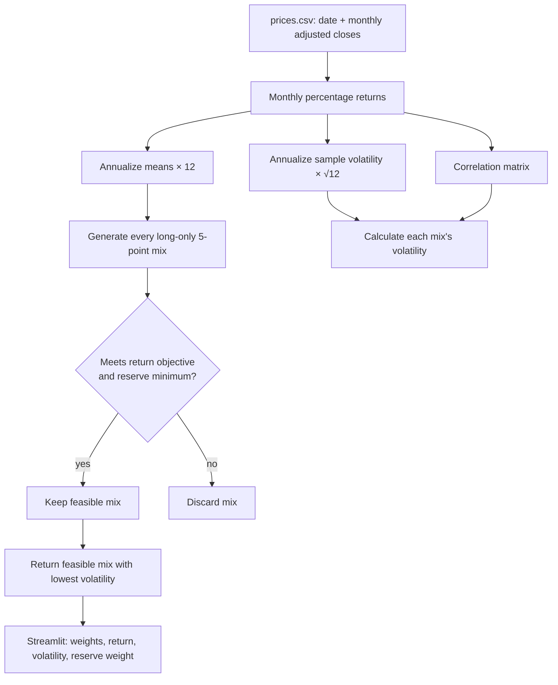

# Lab 15 — Portfolio app

> **Simulated practice submission:** The accompanying `prices.csv` is a synthetic teaching data set, not downloaded market data. Do not represent it as real historical data or cite it as a real source.

Returns estimated from five years of monthly prices are historical estimates, not forecasts.

## Meridian checks

- Baseline: 0% Bills / 20% 10-year / 25% IG / 55% Equity; 6.51% expected return and 9.44% volatility.
- One-point equity estimate stress (8.0% to 7.0%): 0% / 10% / 10% / 80%; 6.53% and 12.94%. Largest weight change: 25 points.
- Changing the IG–Equity correlation to 0.50 in `portfolio.py` changes the result to 0% / 40% / 0% / 60%; 6.52% and 9.73%.

## Simulated practice universe

The simulated universe is BIL (cash-like sleeve), IEF (Treasury-note sleeve), LQD (investment-grade bond sleeve), and VTI (equity sleeve). The synthetic price file is dated 2021-10-31 through 2026-10-31 and is included only to practice the engine workflow. Historical-average returns remain estimates, not forecasts.

Using a 6.5% objective, a 3% reserve minimum, and BIL/IEF marked reserve-eligible:

- **All months:** 40% BIL / 0% IEF / 0% LQD / 60% VTI; estimated return 6.52%, volatility 6.12%, reserve weight 40%.
- **Last 36 months:** 60% BIL / 0% IEF / 0% LQD / 40% VTI; estimated return 6.53%, volatility 2.88%, reserve weight 60%.
- **Largest allocation change:** 20 percentage points (BIL and VTI).

### Simulated stress-test reflection

The Meridian one-point lower equity-return estimate moved 25 percentage points of the allocation. This is estimation risk: a grid optimizer selects a boundary mix based on small return differences, so a one-point change can switch which mix barely clears the objective. I would pilot, not adopt, an optimizer result until a decision-maker establishes return assumptions and a process for updating them.

### Simulated partner-attack example

**Hypothetical attack:** A reviewer lowered the equity expected-return estimate by one percentage point and asked whether an 80% equity result remained appropriate. **Response:** The allocation is not a recommendation; it is evidence that the selected mix is highly sensitive to a single estimated input. I would require review of the estimate and downside-risk limits before using it as a starting allocation.
